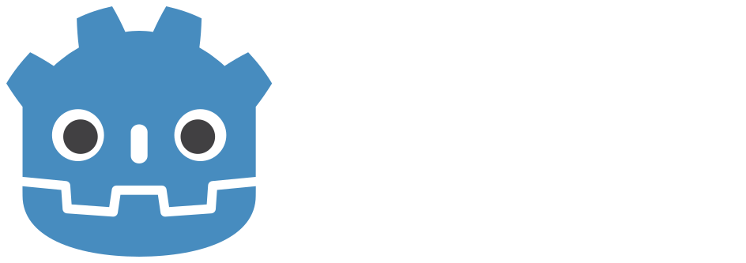
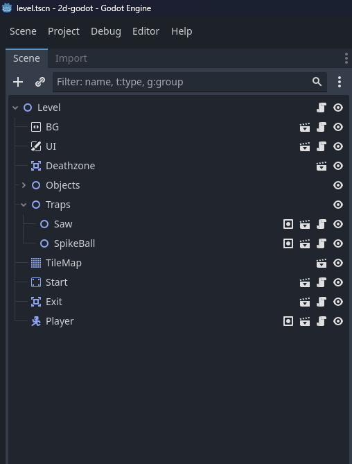
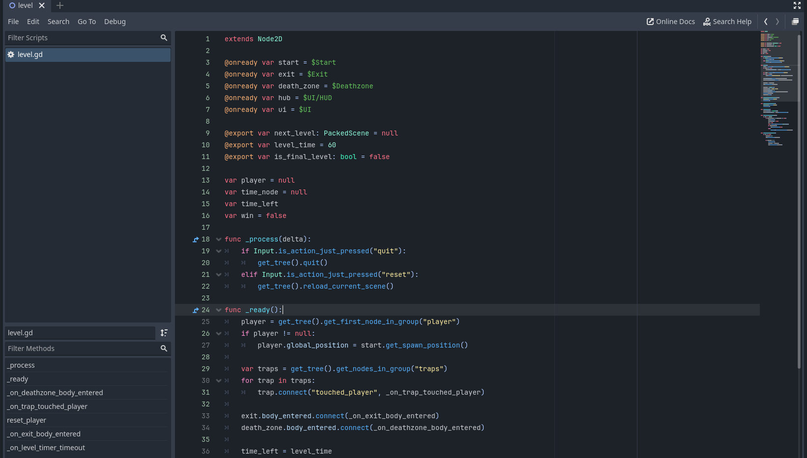
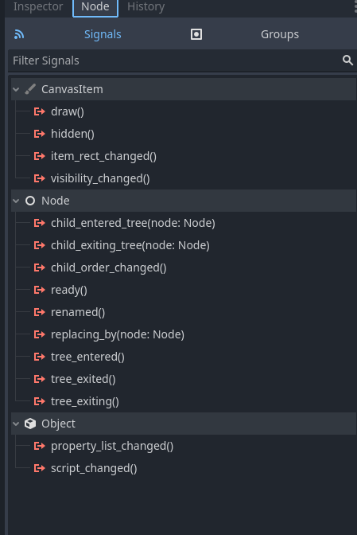
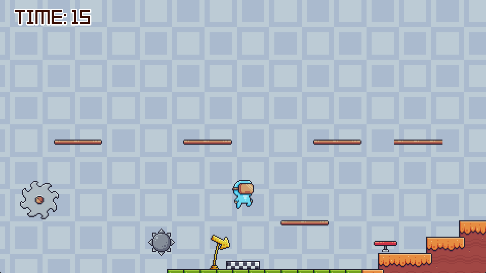

## Trải nghiệm thử một game engine mới: Godot

  

Trong 3 tháng vừa qua, mình dành thời gian để học một game engine mới mang tên <a href="https://godotengine.org/" target="_blank">Godot</a>. 

Cảm giác như Godot rất dễ tiếp cận, giao diện thân thiện và rất gần gũi với Windows Forms trong .NET. Ngôn ngữ chính của Godot là **GDScript**, có cú pháp rất giống Python nên làm quen cực kỳ nhanh.

Giao diện của Godot tạm chia thành các thành phần chính:

|  |
| :---: |
| *Chi tiết của một scene trong Godot* |

|  |
| :---: |
| *Script chứa logic của một scene* |

|  | 
| :---: | 
| *Event và Signals trong Godot* |

Với những ưu điểm vượt trội như: đa nền tảng (Linux, Windows, Mobile), syntax đơn giản và tối ưu hóa thời gian development, mình tin là bất kỳ ai bắt đầu tìm hiểu Godot cũng sẽ cảm thấy vô cùng hào hứng! ✨

---

<small class="text-gray-500">
  Photo by <a href="https://unsplash.com/@mpho_mojapelo?utm_medium=referral&utm_source=unsplash">Mpho Mojapelo</a> on <a href="https://unsplash.com/photos/red-versus-blue-team-foosball-table-UHDx3BHlFvY">Unsplash</a>
</small>